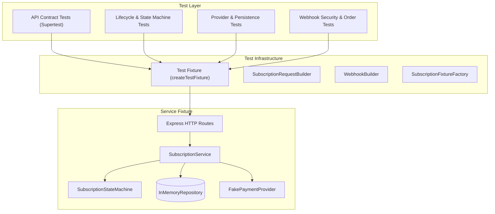
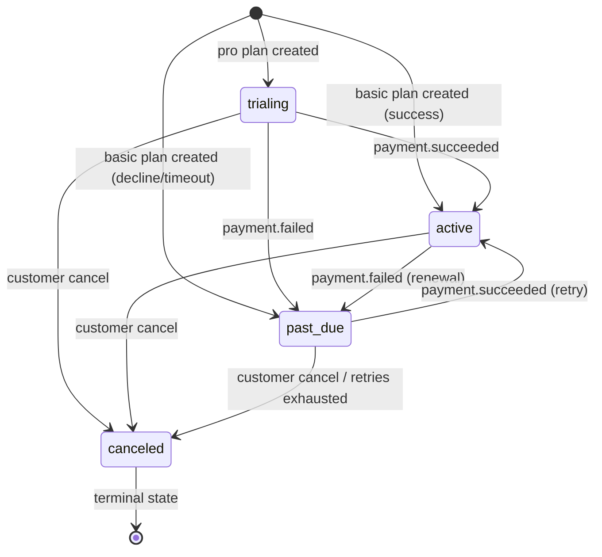

# Kulu SDET Take-Home — Subscription & Billing Automation Framework

A production-grade TypeScript test automation framework and validation fixture for a Subscription & Billing Service. Built with **Jest**, **Supertest**, **TypeScript**, and **Express**, demonstrating clean object-oriented architecture, comprehensive lifecycle state-machine testing, secure webhook validation, and database persistence verification.

---

## Table of Contents
1. [Overview & Architecture](#overview--architecture)
2. [Design Patterns & OOP Architecture](#design-patterns--oop-architecture)
3. [Subscription Lifecycle State Machine](#subscription-lifecycle-state-machine)
4. [Prerequisites & Setup](#prerequisites--setup)
5. [Running Validation & Tests](#running-validation--tests)
6. [API Endpoints & Contracts](#api-endpoints--contracts)
7. [Test Suite Organization & Coverage](#test-suite-organization--coverage)
8. [Assumptions & Limitations](#assumptions--limitations)

---

## Overview & Architecture

Because no existing backend service was provided, this repository includes an executable, typed service fixture coupled with a comprehensive automation test suite:



---

## Design Patterns & OOP Architecture

1. **State Machine (`src/domain/state-machine.ts`)**:
   - Centralizes valid subscription transitions and strictly enforces illegal transition rejection via `InvalidTransitionError`.
   - Exposes inspection helpers: `canTransition(from, to)`, `transition(from, to)`, `getAllowedTransitions(from)`, and `isTerminal(status)`.

2. **Builder Pattern (`src/builders/`)**:
   - `SubscriptionRequestBuilder`: Constructs valid or intentionally malformed payloads with fluent methods (`forCustomer`, `withPlan`, `withPaymentMethod`, `withoutCustomerId`, `withoutPaymentMethod`, `withoutPlan`, `withWhitespaceCustomerId`, `withInvalidPlan`, `buildRaw`).
   - `WebhookBuilder`: Fluently builds HMAC-verifiable webhook payloads, custom amounts, currencies, missing fields, or negative values.

3. **Factory Pattern (`src/factories/subscription-factory.ts`)**:
   - `SubscriptionFixtureFactory`: Pre-seeds repository state in any status (`trialing`, `active`, `past_due`, `canceled`) along with corresponding invoices and audit trails, enabling isolated, declarative scenario setup.

4. **Repository Pattern (`src/repositories/in-memory-repository.ts`)**:
   - Encapsulates storage for `subscriptions`, `invoices`, `webhookEvents`, and `auditEvents`.
   - Exposes query methods: `getSubscription`, `getInvoicesForSubscription`, `findInvoice`, `getEventsForSubscription`, `getAuditForSubscription`, and status counters.

5. **Payment Provider Seam / Test Double (`src/providers/fake-payment-provider.ts`)**:
   - Implements the `PaymentProvider` interface.
   - Captures call count, charge parameters, and idempotency keys.
   - Supports outcome queueing (`setOutcomes(['decline', 'success'])`), single next outcomes (`setNextOutcome`), and timeout simulation.

---

## Subscription Lifecycle State Machine



### Transition Matrix
| Current State | Target State | Legal? | Trigger / Mechanism |
| :--- | :--- | :---: | :--- |
| `trialing` | `active` | Yes | `payment.succeeded` webhook (trial conversion) |
| `trialing` | `past_due` | Yes | `payment.failed` webhook (trial charge failed) |
| `trialing` | `canceled` | Yes | `POST /subscriptions/:id/cancel` during trial |
| `active` | `past_due` | Yes | `payment.failed` webhook (recurring renewal failure) |
| `active` | `canceled` | Yes | `POST /subscriptions/:id/cancel` on active sub |
| `past_due` | `active` | Yes | `payment.succeeded` webhook (recovery / retry) |
| `past_due` | `canceled` | Yes | `POST /subscriptions/:id/cancel` (retries exhausted) |
| `canceled` | `active` | **No** | Rejected; webhooks ignored with `subscription_canceled` |
| `canceled` | `past_due` | **No** | Rejected; webhooks ignored with `subscription_canceled` |
| `canceled` | `canceled` | **No** | API returns `409 Conflict` (Already canceled) |
| `active` | `trialing` | **No** | Illegal regression; `InvalidTransitionError` |
| `past_due` | `trialing` | **No** | Illegal regression; `InvalidTransitionError` |

---

## Prerequisites & Setup

- **Node.js**: v20 or newer (validated on Node.js 20.20.2)
- **npm**: 10.x or newer

```bash
# Clone and enter workspace
cd kulu-sdet-submission

# Install dependencies
npm install
```

---

## Running Validation & Tests

```bash
# Run ESLint check
npm run lint

# Run TypeScript type check (no emit)
npm run build

# Run Jest test suite (in-band)
npm test

# Run complete validation pipeline (lint + build + test)
npm run validate
```

---

## API Endpoints & Contracts

### 1. `POST /subscriptions`
Creates a new subscription.
- **Request Body**:
  ```json
  {
    "customer_id": "cust_123",
    "plan": "basic" | "pro",
    "payment_method_id": "pm_card_4242"
  }
  ```
- **Responses**:
  - `201 Created`: Returns created `Subscription` object (`basic` starts `active` or `past_due`; `pro` starts `trialing`).
  - `400 Bad Request`: Missing fields, blank whitespace, unknown plan, or invalid JSON.

### 2. `GET /subscriptions/:id`
Retrieves subscription details by ID.
- **Responses**:
  - `200 OK`: Returns `Subscription` record.
  - `404 Not Found`: Unknown subscription ID.

### 3. `POST /subscriptions/:id/cancel`
Cancels a subscription (`trialing`, `active`, or `past_due`).
- **Responses**:
  - `200 OK`: Subscription canceled; status updated to `canceled`.
  - `404 Not Found`: Unknown subscription ID.
  - `409 Conflict`: Subscription is already `canceled`.

### 4. `POST /webhooks/payment-provider`
Receives payment gateway notifications with HMAC-SHA256 signature verification.
- **Headers**:
  - `Content-Type: application/json`
  - `X-Provider-Signature: <hex_sha256_digest>`
- **Payload**:
  ```json
  {
    "event_id": "evt_123",
    "type": "payment.succeeded" | "payment.failed" | "payment.refunded",
    "subscription_id": "sub_1",
    "invoice_id": "inv_1",
    "amount": 4900,
    "currency": "USD"
  }
  ```
- **Responses**:
  - `200 OK`: `{ "accepted": true, "duplicate": boolean }`
  - `400 Bad Request`: Malformed JSON, negative amount, missing fields, or invalid currency.
  - `401 Unauthorized`: Missing, malformed, or tampered `X-Provider-Signature`.
  - `404 Not Found`: Webhook references a non-existent subscription ID.

---

## Test Suite Organization & Coverage

```
tests/
├── fixture.ts                                   # Shared test fixture & harness
├── api/
│   └── subscriptions.test.ts                   # Contract & schema tests for REST API
├── lifecycle/
│   └── lifecycle.test.ts                       # State machine unit & E2E lifecycle transitions
├── integration/
│   └── provider-and-persistence.test.ts        # Provider arguments & database invariants
└── webhooks/
    └── webhooks.test.ts                        # HMAC security, idempotency, stale/out-of-order
```

### Coverage Highlights (65 Tests Passing):
1. **API Suite (`tests/api/subscriptions.test.ts`)**:
   - `pro` trial creation without upfront charge.
   - `basic` upfront charge and activation.
   - Validation failures: unknown plans, missing/whitespace `customer_id`, missing `payment_method_id`, empty body.
   - `GET /subscriptions/:id` 200 contract and 404 handling.
   - Cancellation of `trialing`, `active`, and `past_due` subscriptions.
   - 409 Conflict on repeated cancellation and 404 for unknown ID.

2. **Lifecycle Suite (`tests/lifecycle/lifecycle.test.ts`)**:
   - State machine transition table validation for all 7 valid transitions.
   - 5 invalid transition rejections (`canceled->active`, `canceled->past_due`, `canceled->trialing`, `active->trialing`, `past_due->trialing`).
   - Allowed transitions helper and terminal status checks.
   - End-to-end service transitions: `trialing -> active`, `trialing -> past_due`, `trialing -> canceled`, `active -> past_due`, `active -> canceled`, `past_due -> active`, `past_due -> canceled`.
   - Enforcement that webhooks cannot reactivate or fail canceled subscriptions.

3. **Provider & Persistence Integration (`tests/integration/provider-and-persistence.test.ts`)**:
   - Provider argument inspection: `amount`, `currency`, `customerId`, `paymentMethodId`, `idempotencyKey`.
   - Provider outcomes: `success`, `decline`, and `timeout` with matching invoice and audit records.
   - Provider outcome queueing for sequential charges.
   - Verification that database state exactly reconciles with API outputs.

4. **Webhooks Suite (`tests/webhooks/webhooks.test.ts`)**:
   - HMAC-SHA256 signature verification: valid signature, missing signature header, malformed hex, tampered digest.
   - Payload validation: malformed JSON, missing `event_id`, missing `subscription_id`, missing `invoice_id`, negative amount, wrong currency, unknown event type, unknown subscription ID.
   - Duplicate idempotency: duplicate `event_id` returns `{ accepted: true, duplicate: true }` without creating duplicate invoices or audit entries.
   - Stale out-of-order event handling: stale `payment.failed` after `payment.succeeded` does not regress active subscription or overwrite invoice.
   - Duplicate success webhook for already succeeded invoice with different event ID is ignored (`invoice_already_succeeded`).
   - Webhooks for canceled subscriptions ignored (`subscription_canceled`).
   - Refund webhook processing on existing invoices vs orphaned refunds.

---

## Assumptions & Limitations

1. **In-Memory Persistence**: Storage is backed by TypeScript Maps/Sets reset per test fixture. In production, this would be replaced with PostgreSQL with transactions and unique constraints.
2. **Pricing Plans**: Hardcoded to `basic` ($19.00 USD, 0 trial days) and `pro` ($49.00 USD, 14 trial days).
3. **Billing Retries & Scheduler**: Automatic cron-based retry scheduling and notification emails are outside scope. Retries are exercised via explicit webhook delivery.
4. **Plan Changes**: Not part of the assumed API contract.
