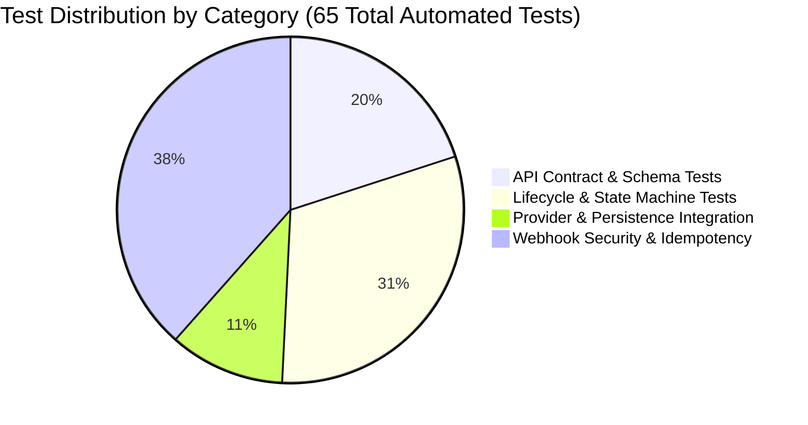

# Comprehensive Test Strategy — Subscription & Billing Automation

## 1. Executive Summary & Quality Goals

The objective of this test framework is to provide rigorous, automated verification of a Subscription & Billing Service. Billing systems are mission-critical financial applications where consistency, idempotency, secure webhook processing, and strict lifecycle state enforcement are paramount.

The test suite validates:
- **API Contracts & Input Sanitization**: Robust handling of happy paths, missing attributes, empty payloads, and invalid parameters.
- **State Machine Integrity**: Deterministic transitions across all valid subscription lifecycle phases and strict rejection of illegal state regressions.
- **Payment Provider Double & Adapter Seam**: Full isolation from external payment gateways while asserting charge argument fidelity, idempotency keys, and outcome variations (`success`, `decline`, `timeout`).
- **Webhook Security & Invariants**: Cryptographic HMAC-SHA256 signature verification using timing-safe comparisons, duplicate delivery deduplication, and out-of-order event resilience.
- **Database & Audit Trail Persistence**: Verification that in-memory storage, invoice records, and audit logs maintain referential integrity and match API responses.

---

## 2. Testing Levels & Pyramidal Distribution

1. **Unit State Machine Verification (`tests/lifecycle/lifecycle.test.ts`)**:
   - Isolates `SubscriptionStateMachine` from HTTP and persistence layers.
   - Parametric testing (`test.each`) validating all 7 valid transitions and 5 illegal transitions.
   - Terminal state and allowed transition query verification.

2. **API Contract & Integration Testing (`tests/api/subscriptions.test.ts`)**:
   - Executes full HTTP requests through Express using Supertest in-process (fast, deterministic, no network port binding needed).
   - Validates response schemas, status codes (200, 201, 400, 404, 409), and database state reconciliation.

3. **Provider & Persistence Integration (`tests/integration/provider-and-persistence.test.ts`)**:
   - Validates the adapter seam between `SubscriptionService` and `FakePaymentProvider`.
   - Asserts exact charge arguments: `customerId`, `paymentMethodId`, `amount` (in cents), `currency` (`USD`), and `idempotencyKey`.
   - Validates outcome handling (`success`, `decline`, `timeout`) and verifies corresponding invoices and audit trails.

4. **Webhook Security & Distributed Invariant Testing (`tests/webhooks/webhooks.test.ts`)**:
   - Cryptographic signature validation with timing-safe comparisons.
   - Comprehensive payload schema validation (negative amounts, missing attributes, unsupported currencies, unknown types).
   - Distributed system edge cases: duplicate event IDs (at-least-once delivery), stale failures arriving after success, and duplicate successes for the same invoice.

---

## 3. Real vs. Mocked Seams

| Component | Real vs Mocked | Rationale |
| :--- | :--- | :--- |
| **HTTP Routing & Middleware** | **Real** (Express + Supertest) | Validates JSON parsing, text body preservation for HMAC, route parameter parsing, error middleware, and HTTP status codes. |
| **Subscription Domain Service** | **Real** (`SubscriptionService`) | Executes real business rules, sequence generation, and database interactions. |
| **State Machine** | **Real** (`SubscriptionStateMachine`) | Executes real transition validation logic without stubbing. |
| **HMAC Signature Verifier** | **Real** (Node.js `crypto`) | Uses real cryptographic SHA256 and `timingSafeEqual` to prevent timing attacks. |
| **Database Persistence** | **In-Memory Fixture** (`InMemoryRepository`) | Standalone, thread-safe, fast Map/Set-based repository initialized per test fixture. Avoids external SQL dependencies while enabling deep assertions on entities. |
| **Payment Gateway** | **Mock / Test Double** (`FakePaymentProvider`) | Real payment gateways (e.g. Stripe, Adyen) must never be invoked in automated test runs. The fake provider records exact charge calls and simulates success, decline, and timeout. |

---

## 4. State Machine & Lifecycle Matrix

### Valid Transitions
| Initial State | Target State | Triggering Mechanism | Persisted Invoices | Audit Reason |
| :--- | :--- | :--- | :--- | :--- |
| `trialing` | `active` | Webhook `payment.succeeded` | Succeeded invoice | `payment.succeeded` |
| `trialing` | `past_due` | Webhook `payment.failed` | Failed invoice | `payment.failed` |
| `trialing` | `canceled` | API `POST /subscriptions/:id/cancel` | None | `customer.cancelled` |
| `active` | `past_due` | Webhook `payment.failed` (renewal) | Failed invoice | `payment.failed` |
| `active` | `canceled` | API `POST /subscriptions/:id/cancel` | None | `customer.cancelled` |
| `past_due` | `active` | Webhook `payment.succeeded` (retry) | Succeeded invoice | `payment.succeeded` |
| `past_due` | `canceled` | API `POST /subscriptions/:id/cancel` | None | `customer.cancelled` |

### Invalid Transitions (Enforced by State Machine & API/Webhooks)
| Initial State | Attempted State | Enforcement Layer | Expected Behavior |
| :--- | :--- | :--- | :--- |
| `canceled` | `active` | Webhook & State Machine | Webhook ignored (`ignoredReason: subscription_canceled`); State machine throws `InvalidTransitionError` |
| `canceled` | `past_due` | Webhook & State Machine | Webhook ignored (`ignoredReason: subscription_canceled`); State machine throws `InvalidTransitionError` |
| `canceled` | `canceled` | API Router | Returns `409 Conflict` ("Subscription is already canceled") |
| `active` | `trialing` | State Machine | Throws `InvalidTransitionError` (illegal backwards transition) |
| `past_due` | `trialing` | State Machine | Throws `InvalidTransitionError` (illegal backwards transition) |
| `canceled` | `trialing` | State Machine | Throws `InvalidTransitionError` (terminal state) |

---

## 5. Webhook Security & Idempotency Strategy

1. **HMAC Signature Verification**:
   - The webhook endpoint captures raw payload bytes via `express.text({ type: 'application/json' })` before JSON parsing.
   - Computes HMAC-SHA256 using the configured shared secret.
   - Compares signatures using `timingSafeEqual` to guard against side-channel timing attacks.
   - Tested scenarios:
     - Valid signature $\to$ `200 OK`
     - Missing `X-Provider-Signature` header $\to$ `401 Unauthorized`
     - Malformed hex string $\to$ `401 Unauthorized`
     - Tampered signature digest $\to$ `401 Unauthorized`

2. **Idempotency & Duplicate Deliveries**:
   - Gateways commonly use at-least-once delivery, resulting in duplicate webhooks.
   - The repository tracks `processedEventIds: Set<string>` and historical deliveries.
   - When a duplicate `event_id` is received:
     - Acknowledges with `200 OK` and `{ accepted: true, duplicate: true }`.
     - Appends delivery record with `duplicate: true` and `ignoredReason: duplicate_event_id`.
     - **Critical Invariant**: Does **not** create duplicate invoice records, does **not** trigger redundant state transitions, and does **not** duplicate audit events.

3. **Out-of-Order Delivery Protection**:
   - **Stale Failure After Success**: If a network delay causes `payment.failed` to arrive after `payment.succeeded` for the same invoice, the failure is ignored (`ignoredReason: stale_failure_after_success`) and does not regress an active subscription to `past_due`.
   - **Duplicate Success with Different Event ID**: If a second success event arrives for an invoice already marked succeeded, it is ignored (`ignoredReason: invoice_already_succeeded`).
   - **Events for Canceled Subscriptions**: A canceled subscription is in a terminal state; subsequent success or failure webhooks are ignored (`ignoredReason: subscription_canceled`).

---

## 6. Database & Audit Trail Invariants

1. **Subscription Status Reconciliation**:
   - The API representation returned by `GET /subscriptions/:id` must strictly match the database record in `InMemoryRepository.subscriptions`.

2. **Invoice Tracking**:
   - Every charge attempt records an `Invoice` containing `subscriptionId`, `amount`, `currency`, `status`, and `providerReference`.
   - Invoices are updated to `'refunded'` upon valid refund webhooks; refunds referencing non-existent invoices are rejected.

3. **Audit Trail Completeness**:
   - Every status transition creates an immutable `AuditEvent` recording `subscriptionId`, previous status `from`, new status `to`, transition `reason`, and timestamp `createdAt`.
   - Creation audit event has `from: null`, `to: 'trialing'`.

---

## 7. OOP & Test Design Patterns

1. **Builder Pattern**:
   - [SubscriptionRequestBuilder](file:///c:/Users/405247/Downloads/kulu-sdet-assignment-download/kulu-sdet-submission/src/builders/subscription-builder.ts): Fluent API for valid payloads and negative tests (`withoutCustomerId`, `withoutPaymentMethod`, `withWhitespaceCustomerId`, `withInvalidPlan`).
   - [WebhookBuilder](file:///c:/Users/405247/Downloads/kulu-sdet-assignment-download/kulu-sdet-submission/src/builders/webhook-builder.ts): Fluent API for webhook payloads, custom currencies, negative amounts, and stripped fields.

2. **Factory Pattern**:
   - [SubscriptionFixtureFactory](file:///c:/Users/405247/Downloads/kulu-sdet-assignment-download/kulu-sdet-submission/src/factories/subscription-factory.ts): Pre-seeds subscriptions in specific states (`trialing`, `active`, `past_due`, `canceled`) with matching invoices and audit history. Decouples test preconditions from multi-step API setup.

3. **Repository Pattern**:
   - [InMemoryRepository](file:///c:/Users/405247/Downloads/kulu-sdet-assignment-download/kulu-sdet-submission/src/repositories/in-memory-repository.ts): Centralizes persistence, query, and lookup methods.

4. **Test Fixture Harness**:
   - [createTestFixture](file:///c:/Users/405247/Downloads/kulu-sdet-assignment-download/kulu-sdet-submission/tests/fixture.ts): Assembles a clean, isolated environment per test with fresh repository, provider double, service, Supertest client, and `postWebhook` helper.

---

## 8. Assumptions & Limitations

1. **In-Memory vs Production SQL**:
   - The in-memory repository is reset per test. It does not validate SQL schema migrations, transaction isolation levels (`SERIALIZABLE` or `READ COMMITTED`), or database deadlocks.
   - **Next Step**: For production readiness, back persistence with PostgreSQL and test concurrency using parallel workers (`Promise.all`).

2. **Billing Scheduler**:
   - Automatic background scheduling of recurring charges or retries is outside the scope of this assignment fixture.

3. **Plan Changes**:
   - Plan upgrades/downgrades and proration calculations are not part of the assumed API contract.
